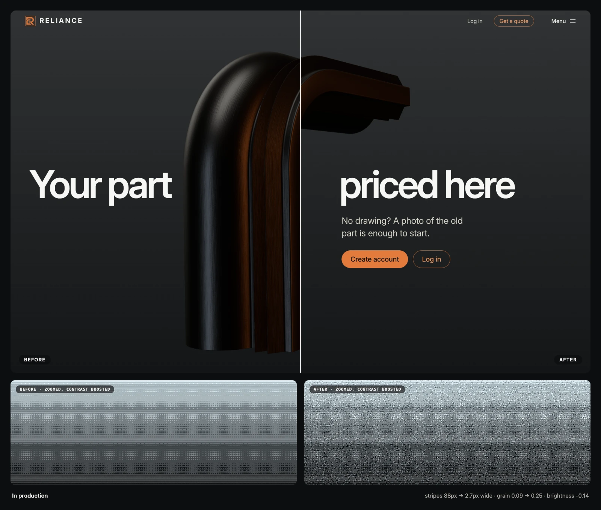

# Grainy Gradients

**The finishing pass for CSS gradients. Measured, not guessed.**

A skill for Claude Code and other coding agents. It adds film grain to your backgrounds so they look printed instead of plastic, removes colour banding, and proves the result with before/after screenshots.


<sub>Every pixel and number is the skill's own output, rendered by `npm run demo`. [Download as MP4](docs/media/demo.mp4).</sub>

## Why not just add noise at 15%?

That is the well-known `feTurbulence` trick, and it works, when the number happens to be right. On a dark gradient 15% is invisible. On a light one it tints the colour. This skill does the trick properly:

| The trick | This skill |
|---|---|
| A guessed opacity | Solves the opacity for a visible-grain target, per background |
| One blend mode | Picks the blend that leaves brightness alone and spreads grain evenly |
| "Looks fine to me" | Photographs the page before and after and measures the pixels |
| One value for every screen | Adapts to HDR screens and the high-contrast setting, off in print |
| A script or image to ship | Plain CSS, nothing at runtime |

## On a real site



A page in production. Left half without the grain, right half with it. The strip underneath is the background zoomed in with the contrast boosted: 88px stripes before, none after.

## Install

Claude Code:

```
/plugin marketplace add Farhad1618/grainy-gradients
/plugin install grainy-gradients@grainy-gradients
```

Codex, Cursor, Gemini CLI, Copilot and others:

```
npx skills add Farhad1618/grainy-gradients
```

Needs Node 22+ and Chrome (or Edge, Brave, Chromium) for the pictures.

## Use

Say it in your own words:

> my hero gradient looks cheap

> go through my site and add grain where it helps

You get a page with a before/after slider for each background. Pick one, press **Done**, and the CSS goes into your project. Then it checks its own work and fails loudly if the grain is missing, the brightness moved, or anything else on the page changed.

## Inside

```
skills/grainy-gradients/
  SKILL.md          what the agent reads
  references/       details it opens only when needed
  scripts/          scan, review, shoot, check and the grain CLI
    engine/         the maths: noise, colour, measuring, solving, CSS
    browser/        code that runs in the page
    headless/       driving Chrome
  assets/           built browser bundles
  calibration.json  targets and screen factors
```

No runtime dependencies. [How it works](docs/how-it-works.md) · [Calibration log](docs/calibration-log.md) · [Changelog](CHANGELOG.md)

## Develop

```
npm install
npm test          # 13 engine tests, then the whole flow on 19 pages in headless Chrome
npm run build     # rebuild assets/ after changing scripts/browser or scripts/engine
npm run demo      # re-render the video (needs ffmpeg and img2webp)
```

MIT
