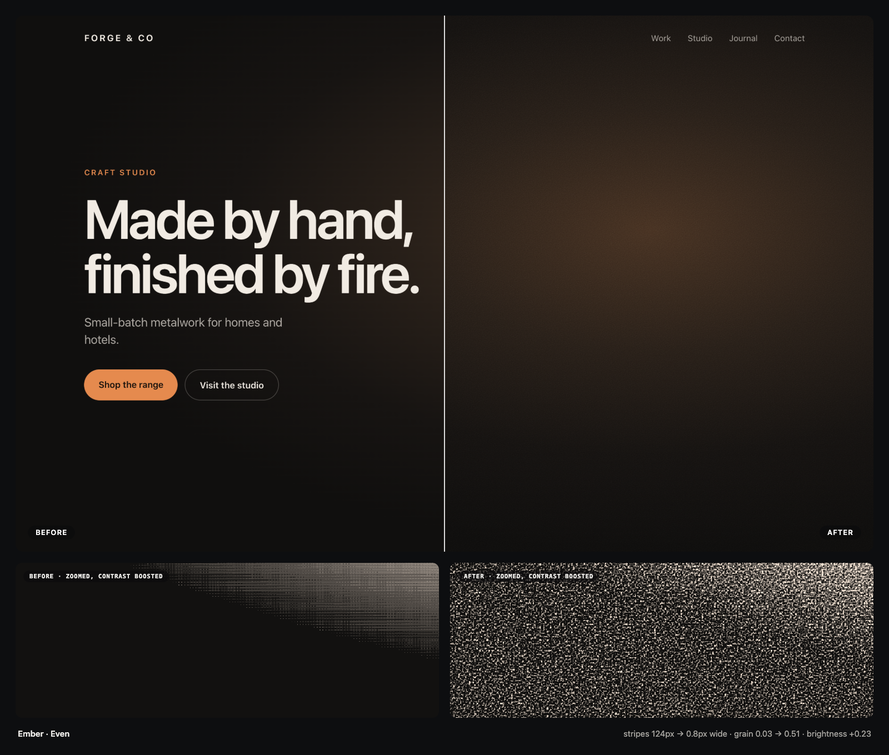
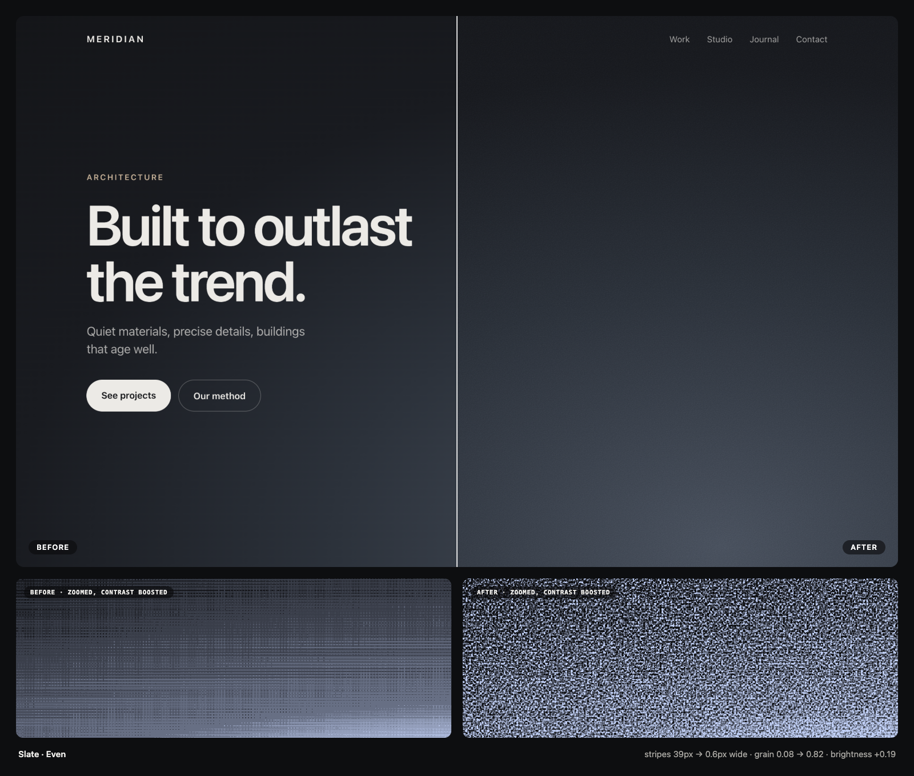
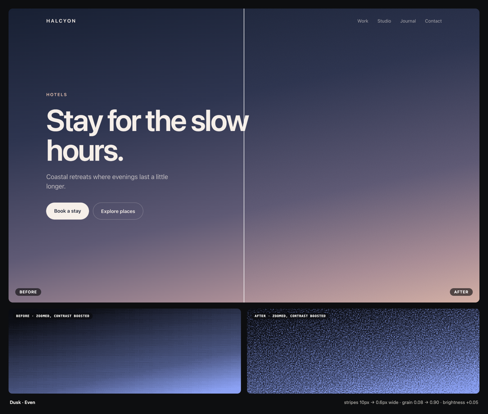
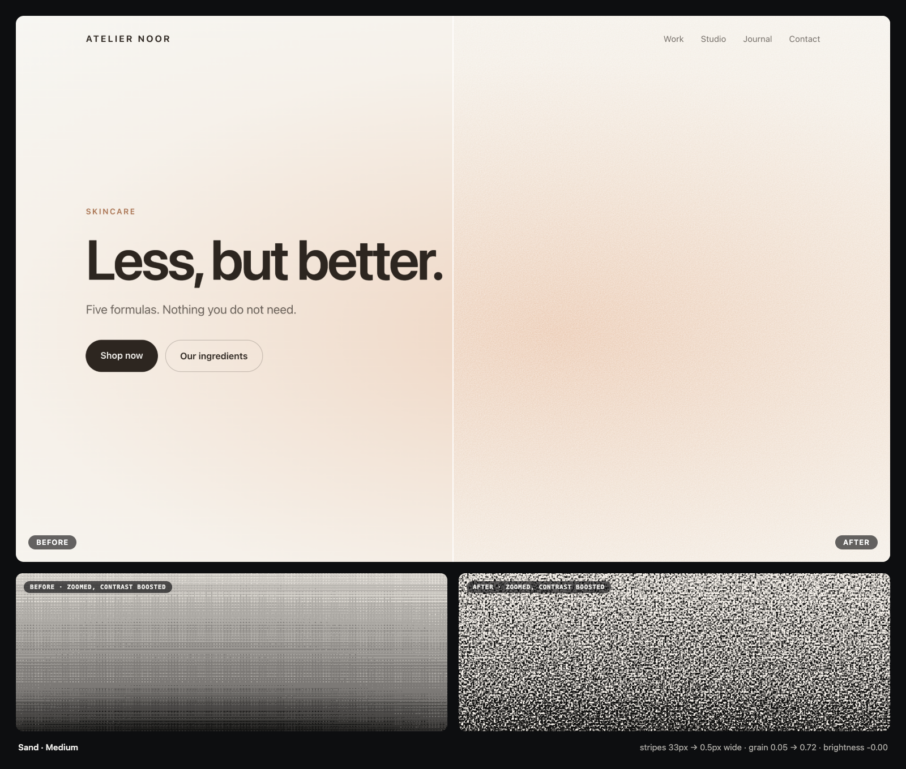
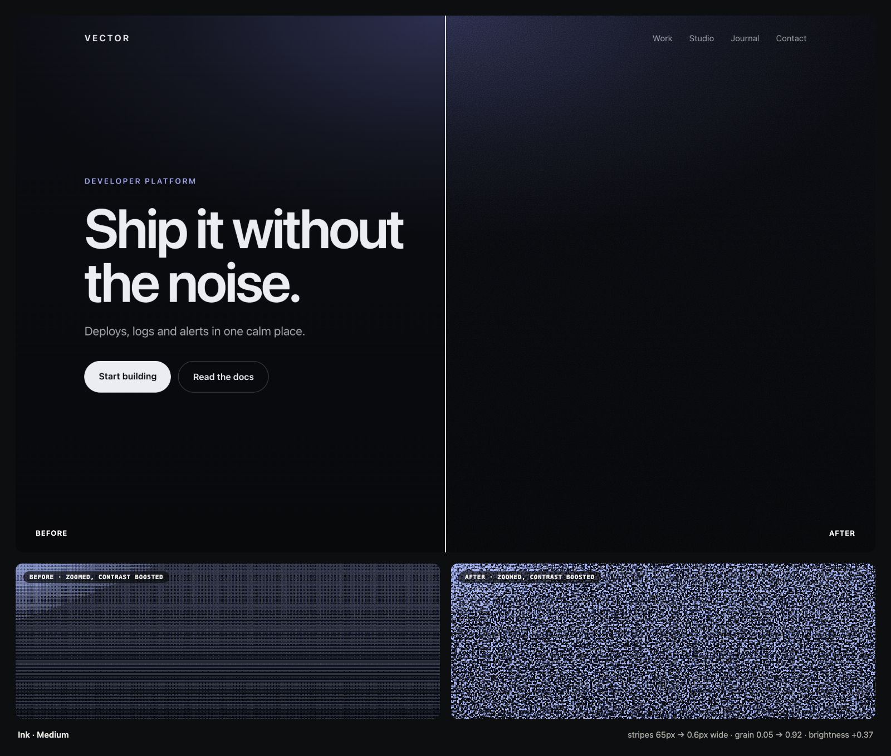

# Grainy Gradients

**Make CSS gradients look printed, not plastic, and get rid of banding stripes.**
A skill for Claude Code. Ask, look at the before/after, pick, done.



## What it fixes

- **Gradients that look cheap.** Too smooth reads as "computer". A fine film grain makes them feel premium.
- **Banding.** The visible stripes in dark or subtle gradients, worst on OLED and mini-LED screens. The grain dissolves them.

It doesn't guess. It measures each background and picks the amount that's visible but never tints your colours. Then it checks its own result with real screenshots.

## Examples

| | |
|---|---|
|  |  |
|  |  |
|  |  |

Left half before, right half after. The strip underneath zooms in and boosts the contrast, so the stripes (before) and the grain (after) are easy to see. Open any picture full size to see the real thing.

## Install

In Claude Code:

```
/plugin marketplace add Farhad1618/grainy-gradients
/plugin install grainy-gradients@grainy-gradients
```

Other agents (Codex, Cursor, Gemini CLI, Copilot):

```
npx skills add Farhad1618/grainy-gradients
```

Needs Node 22+ and Chrome (or Edge, Brave, Chromium).

## Use

Just say it:

> my hero gradient looks cheap

> go through my site and add grain where it helps

You get a page with a before/after slider for each background. Pick one, press **Done**, and the CSS goes into your project.

---

MIT · [How it works](docs/how-it-works.md)
