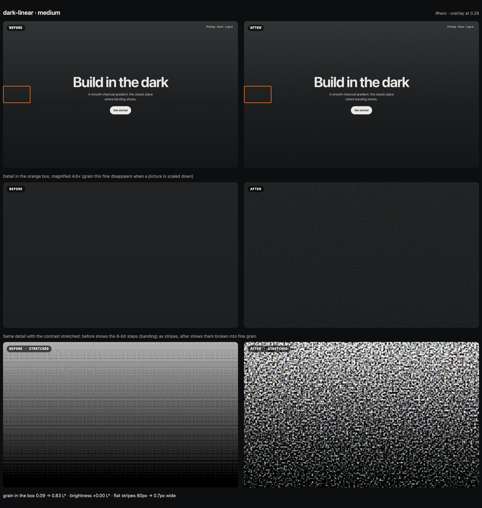
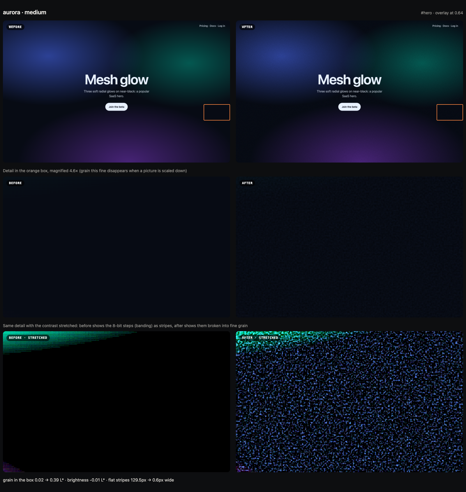
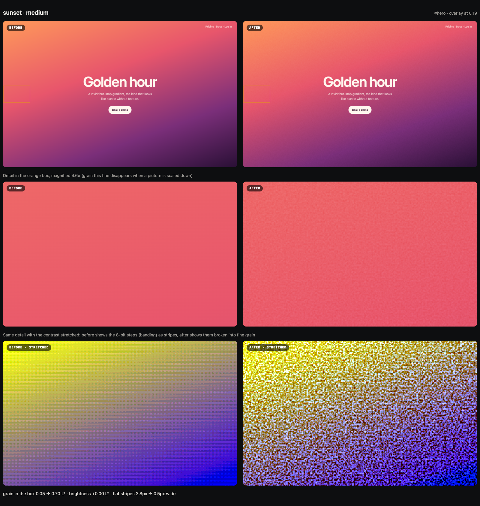
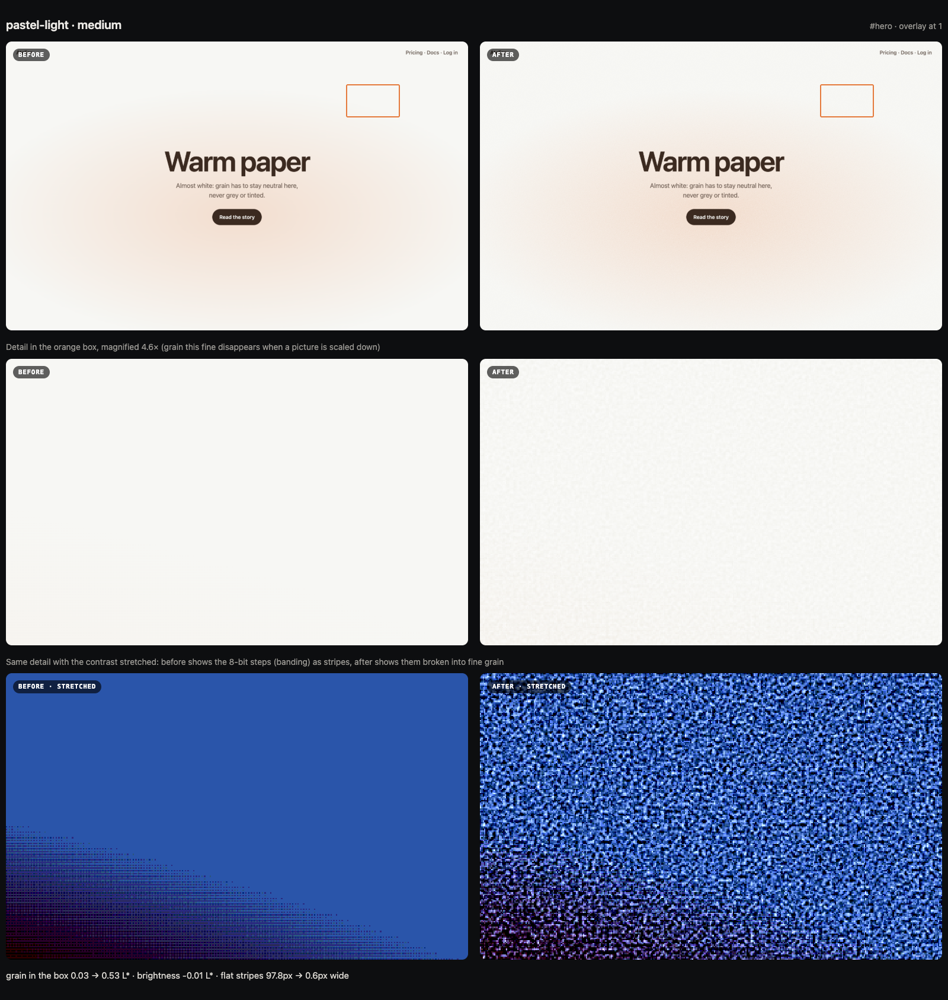
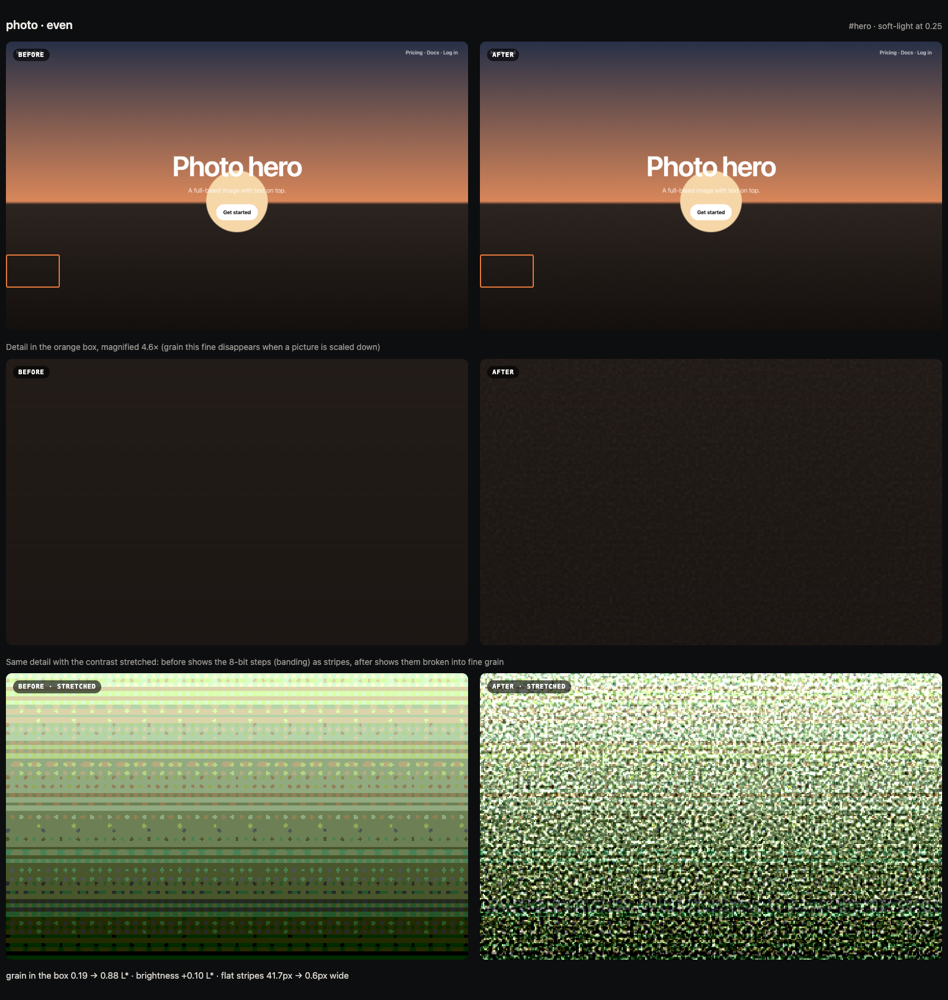
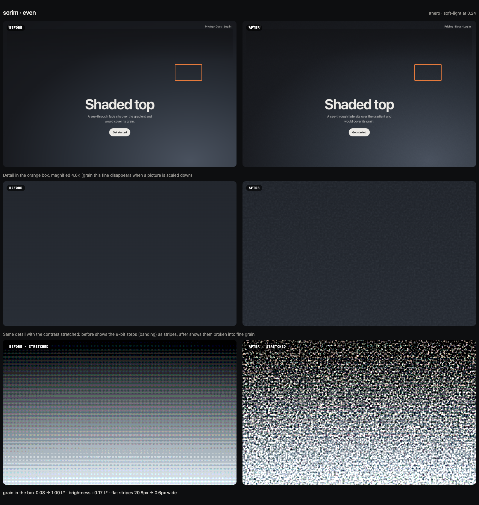
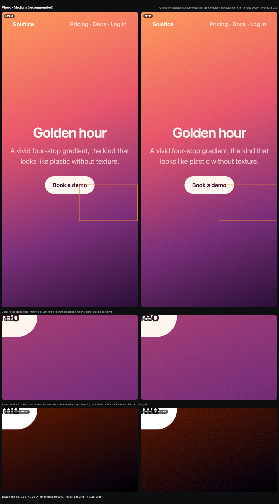

# grain

**Film grain for CSS gradients, measured instead of guessed.** A skill for Claude Code (and other agents that read `SKILL.md`) that makes smooth gradients stop looking cheap and stop banding, then proves it with before/after pictures it takes itself.



<sub>Top: the page. Middle: the area that bands the most, magnified. Bottom: the same area with the contrast stretched, so the 8-bit steps (banding) show as stripes and the grain shows as noise. Measured: grain 0.09 → 0.83 L*, brightness unchanged, flat stripes 80px → 0.7px wide.</sub>

## Why

Smooth digital gradients look like "computer": they're too perfect, and on real screens they break into visible stripes. That's 8-bit banding, worst in dark gradients and on mini-LED and OLED screens. A fine noise layer fixes both: the gradient reads as print or film, and the stripes dissolve.

The usual fix is an `feTurbulence` snippet with `mix-blend-mode: overlay` at about 15% opacity. It has two problems:

1. **The noise is lopsided.** By default it's computed in linearRGB, averages about 73% grey and is half transparent, so it **lightens** the whole page. This skill centres it, so the brightness doesn't move.
2. **One opacity doesn't fit every background.** The same 15% is invisible on near-black and heavy on cream. This skill **measures** each background and solves the blend and opacity for a target amount of *visible* grain (the spread of L*, perceptual lightness).

## What it looks like

| | |
|---|---|
|  |  |
| **Mesh glows on near-black**: stripes 130px → 0.6px | **Vivid four-stop gradient** |
|  |  |
| **Near-white**: grain without turning it grey | **Photo hero**: grain on top of the image, under the text |
|  |  |
| **A dark shade on top**: picks Even (soft-light) and flags the shade | **Phone layout** (390px, 3× screen) |

Each picture was taken by the skill in headless Chrome on the pages in [`tests/pages`](tests/pages). Open one at full size: grain this fine disappears when an image is scaled down, which is why every picture has the magnified rows.

## Install

**Claude Code**

```
/plugin marketplace add Farhad1618/grain-gradients
/plugin install grain@grain-gradients
```

**Other agents** (Codex, Cursor, Gemini CLI, Copilot and others that read Agent Skills):

```
npx skills add Farhad1618/grain-gradients
```

Requires **Node 22+**, plus **Chrome, Chromium, Edge or Brave** for the pictures and checks. It finds them itself, or you can set `CHROME_PATH`. No npm dependencies.

## Use it

Just ask:

- **One place:** "my hero gradient looks cheap" · "the footer has stripes" · "add grain to this background"
- **The whole site:** "go through my codebase and add grain where it helps"

Claude does the rest:

1. **Finds the backgrounds.** For a whole site it scans the code (CSS, Tailwind classes, inline styles, CSS-in-JS) and lists what's worth doing, with a reason for each one it skips (buttons, gradient text, stripe patterns, scrims). You pick all of them or some.
2. **Asks if you want to see it first.** If you do, it opens a **review page**: every background with a before/after slider, **Zoom on banding**, the options (None · Subtle · Medium · Strong · Even, recommended one starred) and a Screen switch. Pick, press **Done**, and your picks go straight back to Claude.
3. **Writes the CSS** into your stylesheet, keeping your own variables and gradients.
4. **Checks its own work.** It photographs the page again and fails loudly unless:
   - the grain is there at the expected amount
   - the brightness didn't move
   - the stripes got narrower
   - nothing else on the page changed or moved
   - there are no new errors
5. **Shows you the evidence:** a before/after picture with the numbers.

Nothing is added to your site except the CSS. The pictures are taken in a separate headless browser.

## What it handles

| Situation | What it does |
|---|---|
| Gradient or flat colour | The noise becomes the element's own top background layer (`background-blend-mode`). No extra elements, and it can't cover text. |
| Background that fades in on scroll | The grain is inside the fading layer, so the colour underneath stays clean. It reports the grain at each stage of the fade. |
| Light-to-dark gradient | Overlay puts most of the grain on the light parts. **Even** (usually soft-light) spreads it evenly, and it's recommended when that's clearly better. |
| Near-white or near-black | Grain that would tint the colour is refused. It gives the most a neutral blend can do, and says so. |
| Photos, ``/`<video>` heroes | A layer right above the image and under the text, scoped so the site's own CSS can't pull it into the layout. |
| Background on `::before`/`::after` | Works, including `position: fixed`. |
| A see-through shade over the background | Detected. It would cover the grain and band again, so the report says how to grain it too. |
| 3D/WebGL backgrounds | The same noise in the fragment shader, read from the page's `--grain` so the amounts match. |
| Every screen | One CSS that adapts: less grain on HDR/OLED screens for dark backgrounds, less with the high-contrast setting, none when printed. |
| Tailwind v4 `oklch`, `color-mix`, React/Vue pages, strict CSP | All handled. These are in the test set. |

## How it works

- **[`grain.js`](skills/grain/scripts/grain.js): the engine.**
  - A JavaScript port of the SVG `feTurbulence` noise. It matches the browser's output: standard deviation 22.7 vs 22.9.
  - The W3C overlay and soft-light formulas.
  - A solver that finds the opacity hitting a visible-grain target.
- **[`look.js`](skills/grain/scripts/look.js): reads the real background in the page.**
  - Every colour format, gradient length and shape.
  - What's behind it and what's on top.
  - Whether it fades.
- **[`scan.mjs`](skills/grain/scripts/scan.mjs): finds backgrounds across a codebase.**
- **[`shoot.mjs`](skills/grain/scripts/shoot.mjs), [`review.mjs`](skills/grain/scripts/review.mjs) and [`check.mjs`](skills/grain/scripts/check.mjs): the pictures, the review page and the check.** They drive headless Chrome over the DevTools protocol with Node's built-in WebSocket.
- **[`calibration.json`](skills/grain/calibration.json): the targets.** 0.5 / 0.8 / 1.4 L* for Subtle / Medium / Strong. Below about 0.45 nobody sees grain.

## Tested

`node tests/run.mjs` runs the whole flow on 13 pages: look → measure → apply → photograph → check.

| Page | Picked | Grain added | Brightness | Flat stripes |
|---|---|---|---|---|
| Dark linear | Medium | +0.88 L* | 0 | 80px → 0.7px |
| Mesh glows | Medium | +1.81 | −0.01 | 130px → 0.6px |
| Tailwind oklch | Medium | +0.98 | 0 | 50px → 0.5px |
| Near-white | Medium | +0.88 | −0.01 | 98px → 0.6px |
| Fixed `body::before` | Medium | +0.89 | +0.01 | 13px → 0.6px |
| Shade on top | Even | +0.88 | +0.17 | 21px → 0.6px |
| Fades in on scroll | Medium | +0.90 | 0 | 43px → 0.6px |
| Rendered late (React-like) | Medium | +0.87 | 0 | 38px → 0.6px |
| Canvas on top | Medium | +0.89 | 0 | 41px → 0.7px |
| Photo hero | Even | +0.94 | +0.10 | 42px → 0.6px |
| Strict CSP | Medium | +0.89 | 0 | 80px → 0.7px |
| Pure black | — | (correctly declines) | 0 | — |

Every case also checks that nothing outside the background changed and that no element moved.

## Calibration

The targets were tuned by eye on real pages, and dark gradients are confirmed. To compare options on several backgrounds side by side, use [`demo/`](demo) (`python3 -m http.server 8090`, then open `/demo/`). Picks are welcome as issues.

## License

MIT
